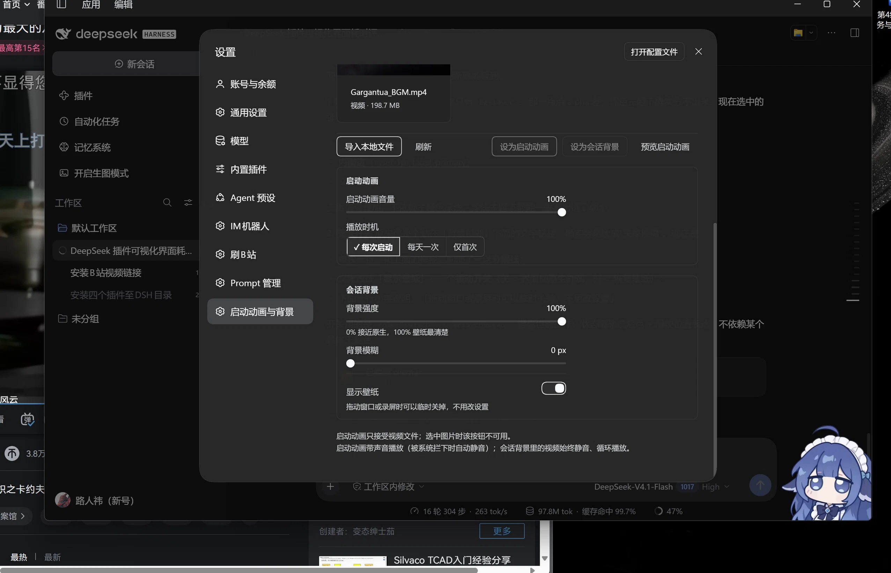

# dsh-visual-deck

> Startup animation & session background manager for [DeepSeek Harness](https://github.com/deepseek-ai).
> Import local images and videos, use a video as the boot animation, and set any image or video as the session background.



## What it does

- **Startup animation** — plays a video full-screen while the app loads, fades away when it ends (click to skip). Sound on by default, volume adjustable, playback cadence: every launch / once a day / first time only.
- **Session background** — a persistent image or video layer behind all panels, with adjustable panel transparency, 0–12 px blur, and a temporary on/off switch.
- **Media library** — three-column wall with video first-frame covers. Import by button, drag & drop, or `Ctrl+V`. Hover any card for quick actions (startup / background / delete).
- **Validation** — a boot animation can only be a video: the button is disabled for images, the host rejects it, and the runtime checks again.

## Install

```bash
dsh plugin --profile desktop add dsh-visual-deck
```

Local tarball or dev link:

```bash
dsh plugin --profile desktop add ./dsh-visual-deck-0.2.0.tgz
dsh plugin --profile desktop add link:/path/to/dsh-visual-deck
```

Open **Settings → Startup animation & background** afterwards.

## Storage

```
~/.dsh/visual-deck/deck.json   # manifest + settings
~/.dsh/visual-deck/media/      # the files themselves
```

## Limits

- 200 MB per file.
- Background videos are always muted (browser autoplay policy).
- H.264/AAC mp4 recommended; HEVC/AV1 may not decode depending on the Electron build.

## License

MIT
